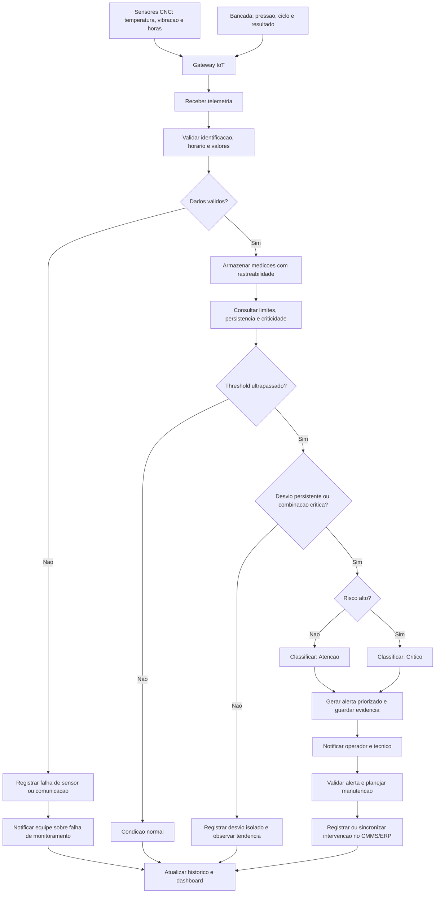
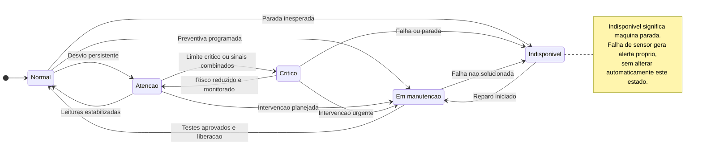

# Projeto IoT Industrial — Diagramas Mermaid

## 1. Fluxo de telemetria e verificação de thresholds

## 2. Máquina de estados do equipamento

## 3. Gatilhos das transições de estado

Cada transição da máquina de estados tem um gatilho no fluxo de atividades do item 1 (mesmo fluxo em [PlantUML.puml](PlantUML.puml) e [d2.d2](d2.d2)). Mapeamento proposto, sem ensaio:

| Transição | Gatilho | Atividade do fluxo que o dispara |
| --- | --- | --- |
| Normal → Atenção | Desvio persistente | "Desvio persistente ou combinação crítica?" = Sim e "Risco alto?" = Não, que leva a "Classificar: Atenção" |
| Atenção → Crítico | Limite crítico ou sinais combinados | "Risco alto?" = Sim, que leva a "Classificar: Crítico" |
| Atenção → Normal | Leituras estabilizadas | "Threshold ultrapassado?" = Não, que leva a "Condição normal" |
| Crítico → Atenção | Risco reduzido e monitorado | Reavaliação com "Risco alto?" = Não |
| Normal → Em manutenção | Preventiva programada | Ordem preventiva no CMMS/ERP, fora do fluxo de telemetria |
| Atenção → Em manutenção | Intervenção planejada | "Validar alerta e planejar manutenção", seguido de "Registrar ou sincronizar intervenção no CMMS/ERP" |
| Crítico → Em manutenção | Intervenção urgente | Mesmo fluxo, com alerta priorizado como Crítico |
| Normal → Indisponível | Parada inesperada | Parada informada pela operação ou pelo CMMS/ERP |
| Crítico → Indisponível | Falha ou parada | Parada informada pela operação ou pelo CMMS/ERP |
| Indisponível → Em manutenção | Reparo iniciado | "Registrar ou sincronizar intervenção no CMMS/ERP" |
| Em manutenção → Normal | Testes aprovados e liberação | Encerramento da intervenção no CMMS/ERP com leituras normais |
| Em manutenção → Indisponível | Falha não solucionada | Encerramento da intervenção sem liberação |

A atividade "Registrar falha de sensor ou comunicação" gera alerta próprio de monitoramento e **não** dispara nenhuma transição: a falha de sensor não prova que a máquina parou.
