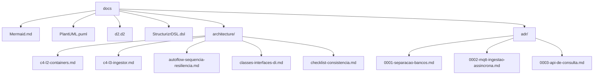

# Documentação viva: AutoFlow Monitor (Grupo 3)

## Índice

| Artefato | Visão | Arquivo |
| --- | --- | --- |
| Fluxo de telemetria e máquina de estados | Comportamental | [Mermaid.md](Mermaid.md), [PlantUML.puml](PlantUML.puml), [d2.d2](d2.d2) |
| Modelo C4 em Structurizr DSL | Arquitetural macro | [StructurizrDSL.dsl](StructurizrDSL.dsl) |
| C4 L2 (contêineres) | Arquitetural macro | [architecture/c4-l2-containers.md](architecture/c4-l2-containers.md) |
| C4 L3 (Ingestor de Telemetria) | Arquitetural macro | [architecture/c4-l3-ingestor.md](architecture/c4-l3-ingestor.md) |
| Sequências de resiliência | Comportamental | [architecture/autoflow-sequencia-resiliencia.md](architecture/autoflow-sequencia-resiliencia.md) |
| Classes, interfaces e injeção de dependência | Estrutural | [architecture/classes-interfaces-di.md](architecture/classes-interfaces-di.md) |
| Checklist de consistência | Governança | [architecture/checklist-consistencia.md](architecture/checklist-consistencia.md) |
| ADR 0001, 0002 e 0003 | Governança | [adr/](adr/) |

O nome do arquivo D2 é `d2.d2`, em minúsculas; em sistemas que diferenciam maiúsculas, `D2.d2` não o encontra.
