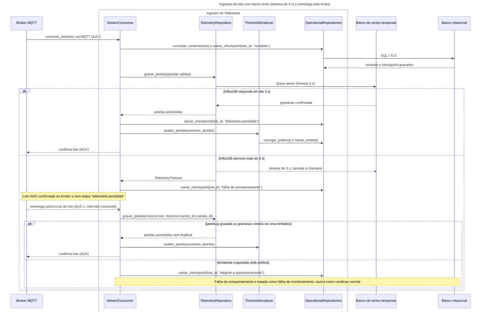
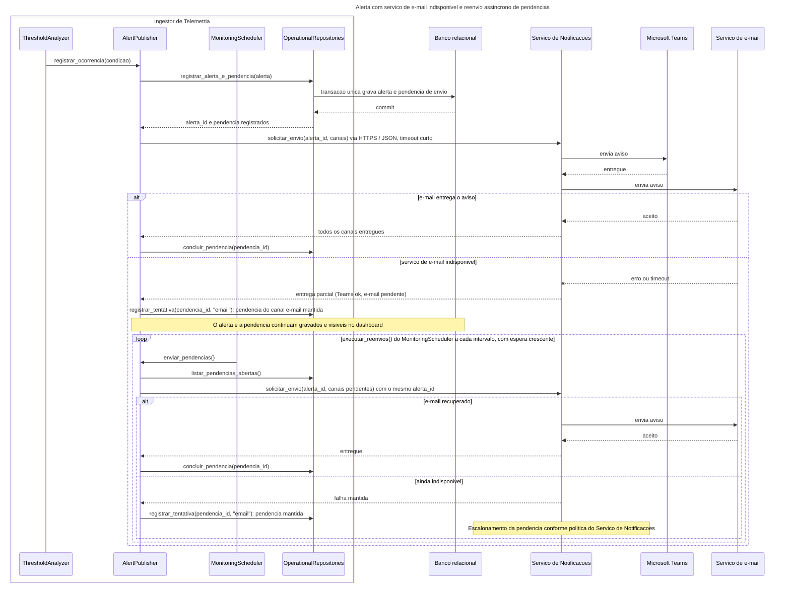
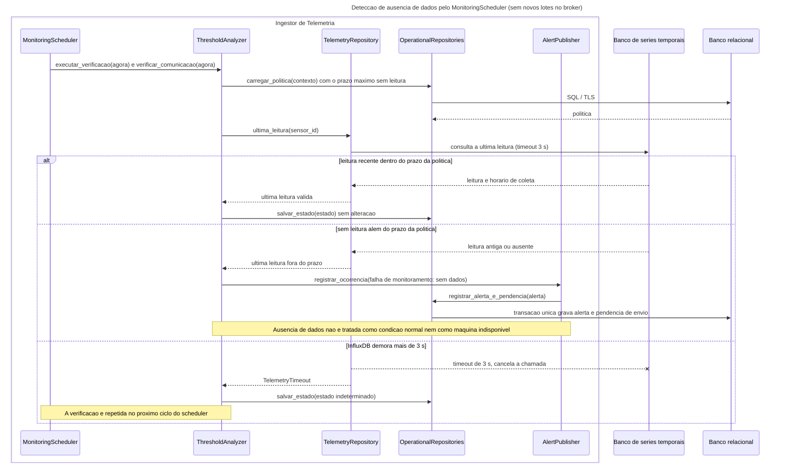

# AutoFlow Monitor: Diagramas de sequência com cenários de falha

## Situação da proposta

Modelo acadêmico proposto em 17/11/2026 para o Grupo 3 (Passo 2 do laboratório agêntico). Os participantes usam os mesmos nomes do [C4 L2](c4-l2-containers.md) e do [C4 L3](c4-l3-ingestor.md); métodos como `consumir_lote`, `avaliar_janelas`, `registrar_alerta_e_pendencia` e `executar_reenvios` seguem os contratos conceituais do L3. Prazos e políticas de repetição são parâmetros propostos, ainda sem ensaio, e este documento não comprova desempenho ou implementação.

Fluxo principal: o gateway publica um lote, o ingestor o grava, avalia os limites, registra o alerta e solicita a notificação. Cada cenário abaixo injeta uma falha nesse fluxo; o cenário 3 mostra a detecção de ausência de dados, que não depende da chegada de lotes. A retentativa é assíncrona: no cenário 1 pela reentrega do broker MQTT (ver [ADR 0002](../adr/0002-mqtt-ingestao-assincrona.md)); no cenário 2 pela pendência persistida e pelo `MonitoringScheduler`.

## Cenário 1: banco de séries temporais demora mais de 3 segundos

Fonte: [autoflow-sequencia-ingestao-timeout.mmd](autoflow-sequencia-ingestao-timeout.mmd).

Pontos de resiliência: o lote só é confirmado ao broker depois da gravação; o checkpoint permanece em "recebido" após a falha; a reentrega usa os mesmos `evento_id` e `janela_id`, portanto não duplica janelas nem alertas; esgotadas as tentativas, o lote fica elegível a reprocessamento e a falha é tratada como falha de monitoramento, não como condição normal.

## Cenário 2: serviço de e-mail indisponível

Fonte: [autoflow-sequencia-notificacao-falha.mmd](autoflow-sequencia-notificacao-falha.mmd).

Pontos de resiliência: alerta e pendência são gravados na mesma transação PostgreSQL antes de qualquer chamada externa; a queda do e-mail não impede o aviso por Teams nem a consulta do alerta no dashboard; o reenvio reutiliza `alerta_id` como chave de idempotência, evitando avisos duplicados; o escalonamento da pendência é responsabilidade do Serviço de Notificações, conforme o C4 L3.

## Cenário 3: ausência de dados sem novos lotes no broker

Fonte: [autoflow-sequencia-ausencia-dados.mmd](autoflow-sequencia-ausencia-dados.mmd).

Pontos de resiliência: a detecção não depende da chegada de lotes, porque quem dispara a verificação é o `MonitoringScheduler`; a falta de leitura dentro do prazo da política vira falha de monitoramento, nunca condição normal e nunca máquina indisponível (a falha de sensor tem alerta próprio, conforme a máquina de estados); a consulta ao InfluxDB também tem timeout de 3 s e, se estourar, o estado fica indeterminado e a verificação se repete no próximo ciclo.

## Parâmetros propostos (a validar)

Os valores abaixo são propostas para o piloto, sem ensaio. Só o timeout de 3 s vem do enunciado dos cenários; os demais são pontos de partida a confirmar ou ajustar na revisão e devem ser medidos nos critérios de validação da [ADR 0002](../adr/0002-mqtt-ingestao-assincrona.md).

| Parâmetro | Valor proposto | Onde aparece | Justificativa e risco |
| --- | --- | --- | --- |
| Timeout de gravação e consulta no InfluxDB | 3 s | Cenários 1 e 3 | Mantém o consumo do lote responsivo; um valor curto demais gera reentregas desnecessárias. |
| Entrega do lote pelo broker | MQTT QoS 1, ao menos uma vez | Cenário 1 | Garante a reentrega, mas admite duplicata; por isso `evento_id` e `janela_id` são idempotentes. |
| Limite de reentregas por lote | 5 tentativas (a confirmar) | Cenário 1 | Evita reentrega infinita de lote inválido; passado o limite o lote fica elegível a reprocessamento, sem descarte silencioso. |
| Espera entre reentregas | Crescente, 5 s dobrando até 5 min (a confirmar) | Cenário 1 | Dá tempo ao banco de se recuperar sem reentregar em rajada. |
| Timeout da chamada ao Serviço de Notificações | Curto, 5 s (a confirmar) | Cenário 2 | A chamada nunca fica no caminho de confirmação do lote (auditoria do [C4 L2](c4-l2-containers.md)). |
| Intervalo de `executar_reenvios()` | 60 s com espera crescente por pendência (a confirmar) | Cenário 2 | Repete pendências sem sobrecarregar um canal que ainda está fora. |
| Intervalo de `executar_verificacao(agora)` | Menor que o prazo de detecção da política | Cenário 3 | O L3 exige que o intervalo cumpra o prazo de detecção configurado. |

## Mensagens e métodos usados

Todo método chamado nos diagramas existe nas interfaces do [diagrama de classes](classes-interfaces-di.md): `consumir_lote`, `consultar_contexto`, `salvar_checkpoint`, `gravar_janelas`, `avaliar_janelas`, `carregar_politica`, `salvar_estado`, `registrar_ocorrencia`, `registrar_alerta_e_pendencia`, `solicitar_envio`, `listar_pendencias_abertas`, `registrar_tentativa`, `concluir_pendencia`, `enviar_pendencias`, `executar_verificacao`, `executar_reenvios`, `verificar_comunicacao` e `ultima_leitura`.

## Referências

- Mermaid: [Sequence diagrams](https://mermaid.js.org/syntax/sequenceDiagram.html).
- ADR 0001: [separação dos bancos](../adr/0001-separacao-bancos.md).
