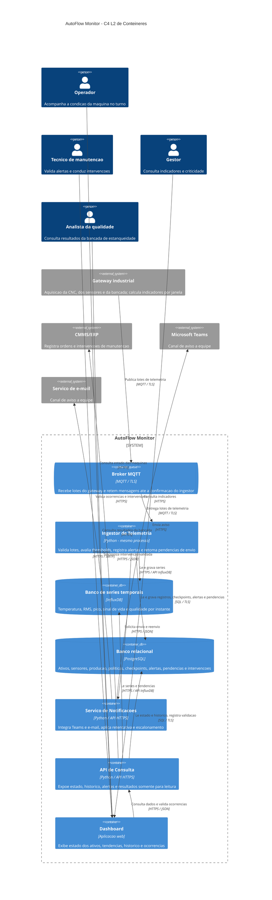

# AutoFlow Monitor: C4 Nível 2 (Contêineres) e auditoria de acoplamento

## Situação da proposta

Modelo acadêmico proposto em 17/11/2026 para o Grupo 3 (Passo 1 do laboratório agêntico). Os contêineres e as tecnologias (Python, MQTT, PostgreSQL, InfluxDB) são os mesmos do [C4 L3 do Ingestor](c4-l3-ingestor.md) e da [ADR 0001](../adr/0001-separacao-bancos.md). Este documento não comprova implementação, integração ou desempenho. O arquivo-fonte do diagrama é [autoflow-c4-l2-containers.mmd](autoflow-c4-l2-containers.mmd).

Os contêineres **API de Consulta** e **Dashboard** são citados no C4 L3 como fora do zoom do ingestor; aqui eles passam a constar no L2. A API de Consulta é uma proposta desta sprint: ela substitui o acesso direto do dashboard ao banco, previsto no modelo Structurizr da sprint anterior. O [StructurizrDSL.dsl](../StructurizrDSL.dsl) foi atualizado nesta sprint para refletir este L2 e o [C4 L3](c4-l3-ingestor.md); a decisão sobre a API de Consulta está na [ADR 0003](../adr/0003-api-de-consulta.md).

## Auditoria arquitetural (3 tópicos)

1. **Acoplamento síncrono Ingestor → Serviço de Notificações (HTTPS).** Uma lentidão ou queda do serviço, ou do Teams/e-mail atrás dele, poderia bloquear o consumo de lotes. O modelo já mitiga isso: alerta e pendência são gravados na mesma transação PostgreSQL antes da chamada, e o `MonitoringScheduler` repete as falhas depois. No L2, a chamada deve ter timeout curto e chave de idempotência (identificador do alerta), e nunca ficar no caminho de confirmação do lote.
2. **Pontos de falha única (SPOF).** Broker MQTT, PostgreSQL, InfluxDB e a instância única do Ingestor são pontos únicos no piloto. A perda do PostgreSQL é a mais grave: ele guarda checkpoints, alertas e pendências. Mitigação proposta: confirmação manual do lote só depois da gravação (o broker retém e reentrega), checkpoints por lote, reprocessamento idempotente e backup/restauração dos dois bancos. Réplicas e alta disponibilidade ficam fora do piloto e dependem de medição.
3. **Acesso de leitura aos dois bancos.** Dashboard e consultas combinadas poderiam acoplar a interface aos esquemas de PostgreSQL e InfluxDB e disputar recursos com o ingestor. Correção aplicada: o Dashboard fala só com a API de Consulta, que acessa os bancos por repositórios próprios, em modo leitura (exceto o registro de validação de ocorrência), e é o único ponto de integração com o CMMS/ERP.

## Diagrama

## Correspondência com os demais artefatos

| Contêiner no L2 | Nome no C4 L3 / sequência | Observação |
| --- | --- | --- |
| Broker MQTT | Broker MQTT | Mesmo nome e tecnologia. |
| Ingestor de Telemetria | Ingestor de Telemetria | O L3 abre este contêiner (StreamConsumer, ThresholdAnalyzer, AlertPublisher, MonitoringScheduler, TelemetryRepository, OperationalRepositories). |
| Banco de series temporais | Banco de series temporais | InfluxDB, ver ADR 0001. |
| Banco relacional | Banco relacional | PostgreSQL, ver ADR 0001. |
| Servico de Notificacoes | Servico de Notificacoes | Integra Teams e e-mail. |
| API de Consulta, Dashboard | Fora do zoom do L3 | Novos no L2. |

Os fluxos de falha entre esses contêineres estão em [autoflow-sequencia-resiliencia.md](autoflow-sequencia-resiliencia.md). A escolha do broker consta na [ADR 0002](../adr/0002-mqtt-ingestao-assincrona.md).

## Referências

- C4 Model: [Container diagram](https://c4model.com/diagrams/container).
- Mermaid: [C4 Diagrams](https://mermaid.js.org/syntax/c4).
