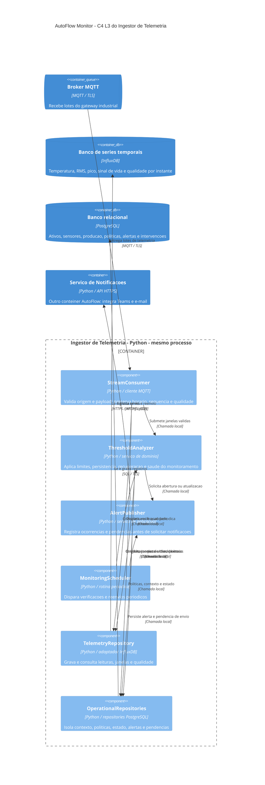

# AutoFlow Monitor: C4 Nível 3 do Ingestor de Telemetria

## Situação da proposta

Modelo acadêmico proposto em 03/11/2026 para o Grupo 3. Python, MQTT, PostgreSQL e InfluxDB são escolhas propostas para esta atividade; este documento não comprova implementação, integração ou desempenho.

## Escopo do zoom

O diagrama abre somente o contêiner Ingestor de Telemetria do AutoFlow Monitor. Todos os componentes dentro da fronteira executam no mesmo processo Python. Broker, bancos e serviço de notificações são outros contêineres. A CNC, os sensores e a bancada fornecem dados por meio da aquisição industrial; o broker representa a integração diretamente conectada ao ingestor.

Dashboard e API de consulta ficam fora deste zoom. No C4 L2 do AutoFlow, apresentar também esses contêineres e suas conexões. Um contêiner C4 representa uma aplicação ou armazenamento; sua implementação não exige Docker.

## Diagrama

## Componentes e contratos

| Componente | Responsabilidade | Interface lógica proposta | Dependências permitidas |
| --- | --- | --- | --- |
| StreamConsumer | Consumir lotes, validar estrutura/origem, preservar qualidade e controlar reprocessamento. | consumir_lote(lote) | Repositórios e ThresholdAnalyzer. |
| ThresholdAnalyzer | Aplicar políticas por contexto, persistência, recuperação e verificações de comunicação. | avaliar_janelas(contexto, janelas); verificar_comunicacao(agora) | Repositórios e AlertPublisher. |
| AlertPublisher | Registrar ocorrência e pendência antes de solicitar comunicação; retomar pendências após falha. | registrar_ocorrencia(condicao); enviar_pendencias() | OperationalRepositories e API do serviço de notificações. |
| MonitoringScheduler | Agendar verificações de comunicação e retomada de pendências, incluindo períodos sem mensagens. | executar_verificacao(agora); executar_reenvios() | ThresholdAnalyzer e AlertPublisher. |
| TelemetryRepository | Isolar consultas e gravações das séries temporais. | gravar_janelas(); consultar_janela(); ultima_leitura() | Cliente InfluxDB. |
| OperationalRepositories | Agrupar repositórios de origem, contexto, políticas, estado, checkpoints, alertas e pendências. | consultar_contexto(); carregar_politica(); salvar_estado(); registrar_alerta_e_pendencia() | Cliente PostgreSQL. |

São contratos conceituais para orientar a implementação, sem compromisso com assinaturas definitivas de código. OperationalRepositories representa um grupo coeso de repositórios, com interfaces específicas por responsabilidade.

## Processamento e confiabilidade

1. A aquisição industrial calcula os indicadores de vibração por janela e envia lotes com identificadores, sequência e horários de coleta. O banco temporal recebe temperatura e indicadores como RMS e pico, além da qualidade e do sinal de vida.
2. StreamConsumer valida ativo, sensor, unidade, faixa física, contexto e sequência. Leituras inválidas preservam motivo e qualidade, sendo excluídas da classificação de condição e do treinamento.
3. TelemetryRepository preserva o horário de coleta e grava as janelas. Checkpoints distinguem lote recebido, telemetria persistida e regras avaliadas.
4. ThresholdAnalyzer processa janelas válidas em ordem de coleta e com políticas da operação, ferramenta e regime. Lacunas e alterações de contexto reiniciam a persistência conforme RN03.
5. AlertPublisher registra o alerta e a pendência de comunicação em uma transação do PostgreSQL. A tentativa de entrega ocorre depois; falhas preservam a pendência para nova tentativa.
6. MonitoringScheduler dispara a investigação de ausência de dados mesmo quando o broker não entrega novos lotes e aciona AlertPublisher para retomar pendências de envio. A última leitura de cada sensor e o sinal de vida do gateway são avaliados separadamente.

A avaliação periódica também pode disparar o tratamento de escalonamento por uma política registrada, mesmo sem novos eventos industriais. O intervalo de execução deve ser definido e testado para cumprir o prazo de detecção configurado. O escalonamento de pendências de comunicação é responsabilidade do serviço de notificações.

Mensagens reenviadas devem ser idempotentes: a mesma janela não pode incrementar novamente as contagens de persistência nem duplicar ocorrências. A identidade do evento deve permanecer estável durante o reprocessamento. Uma janela incompleta ou fora de ordem precisa de tratamento explícito; o lote não é uma única amostra.

O ingestor não comanda a CNC nem libera peças. Um pico ou uma reprovação apenas fornece evidência para investigação. A falta de dados gera indisponibilidade ou condição indeterminada, em vez de comprovar condição normal.

## Regras de acoplamento

- StreamConsumer utiliza os repositórios e o serviço de avaliação. MonitoringScheduler aciona ThresholdAnalyzer e AlertPublisher. Esses componentes não executam SQL nem acessam InfluxDB diretamente.
- ThresholdAnalyzer concentra a avaliação das políticas. Interfaces de entrada e adaptadores não repetem essas regras.
- O acesso aos bancos passa pelos respectivos repositórios.
- A integração com Teams e e-mail pertence ao serviço de notificações. Credenciais permanecem no servidor.
- As dependências indicadas no diagrama são as permitidas. Novas dependências exigem revisão do modelo e, quando significativas, uma ADR.

Estas são regras propostas. Sua aplicação por análise automática de imports e CI ainda deve ser implementada. A estrutura ilustrativa de módulos é: entrada, dominio, aplicacao, portas e infraestrutura. Testes com repositórios substitutos devem verificar as regras sem depender de bancos externos.

## Referências

- C4 Model: [Component diagram](https://c4model.com/diagrams/component).
- Mermaid: [C4 Diagrams](https://mermaid.js.org/syntax/c4).
- PostgreSQL: [Constraints](https://www.postgresql.org/docs/current/ddl-constraints.html).
- InfluxData: [Write data to InfluxDB 3 Core](https://docs.influxdata.com/influxdb3/core/write-data/).

Consultar a ADR 0001 para o motivo da separação dos armazenamentos.
