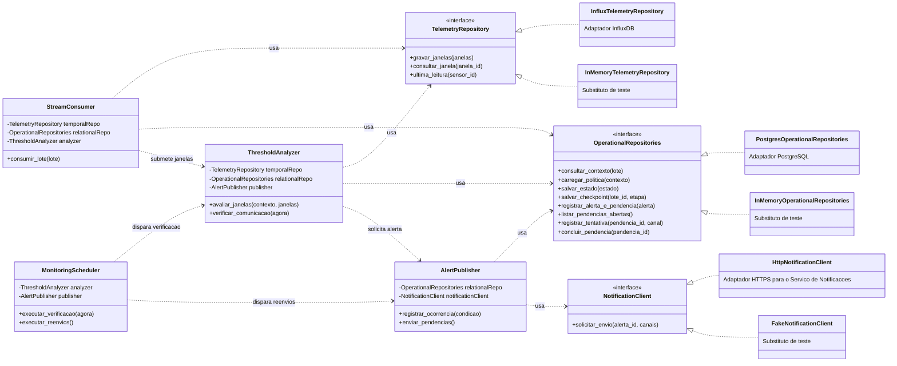

# AutoFlow Monitor: Classes, interfaces e injeção de dependência do Ingestor

## Situação da proposta

Modelo acadêmico proposto em 17/11/2026 para o Grupo 3. Detalha em classes o que o [C4 L3](c4-l3-ingestor.md) mostra em componentes, para evidenciar o desacoplamento por interfaces exigido no Passo 4 do laboratório. As assinaturas são ilustrativas e não representam código implementado. Os métodos `salvar_checkpoint`, `listar_pendencias_abertas`, `registrar_tentativa`, `concluir_pendencia` e `solicitar_envio` foram acrescentados para sustentar os fluxos dos [diagramas de sequência](autoflow-sequencia-resiliencia.md) e já constam na tabela de contratos do L3.

## Diagrama

Fonte: [autoflow-classes-interfaces-di.mmd](autoflow-classes-interfaces-di.mmd).

## Como o desacoplamento é obtido

| Princípio | Aplicação no modelo |
| --- | --- |
| Dependência de abstrações | `StreamConsumer`, `ThresholdAnalyzer` e `AlertPublisher` dependem das interfaces `TelemetryRepository`, `OperationalRepositories` e `NotificationClient`, nunca das classes concretas. |
| Injeção de dependência por construtor | Cada serviço recebe suas dependências no construtor (atributos privados do diagrama). Nenhum serviço instancia um adaptador. |
| Raiz de composição | Um único ponto de montagem na camada de infraestrutura cria `InfluxTelemetryRepository`, `PostgresOperationalRepositories` e `HttpNotificationClient` e os injeta nos serviços. |
| Substituição em testes | Os repositórios e o cliente de notificações têm implementações substitutas (`InMemory...`, `Fake...`), o que permite verificar as regras sem bancos externos. |
| Regras de acoplamento | Apenas os adaptadores conhecem SQL, a API InfluxDB e HTTPS; os serviços usam somente as interfaces, como previsto nas "Regras de acoplamento" do C4 L3 e na [ADR 0001](../adr/0001-separacao-bancos.md). |

`OperationalRepositories` é tratada aqui como uma interface agregadora, simplificação do grupo de repositórios por responsabilidade descrito no L3. Em uma implementação, ela pode ser dividida em interfaces menores (contexto, política, estado, checkpoint, alerta).

## Rastreabilidade dos métodos

Todo método chamado nas sequências existe em uma das interfaces abaixo. A coluna "Sequência" indica onde ele é usado: 1 = InfluxDB lento, 2 = e-mail indisponível, 3 = ausência de dados.

| Método | Interface ou classe | Sequência | Componente no C4 L3 |
| --- | --- | --- | --- |
| `consumir_lote(lote)` | `StreamConsumer` | 1 | StreamConsumer |
| `avaliar_janelas(contexto, janelas)` | `ThresholdAnalyzer` | 1 | ThresholdAnalyzer |
| `verificar_comunicacao(agora)` | `ThresholdAnalyzer` | 3 | ThresholdAnalyzer |
| `registrar_ocorrencia(condicao)` | `AlertPublisher` | 2, 3 | AlertPublisher |
| `enviar_pendencias()` | `AlertPublisher` | 2 | AlertPublisher |
| `executar_verificacao(agora)` | `MonitoringScheduler` | 3 | MonitoringScheduler |
| `executar_reenvios()` | `MonitoringScheduler` | 2 | MonitoringScheduler |
| `gravar_janelas(janelas)` | `TelemetryRepository` | 1 | TelemetryRepository |
| `consultar_janela(janela_id)` | `TelemetryRepository` | não usado nas sequências | TelemetryRepository |
| `ultima_leitura(sensor_id)` | `TelemetryRepository` | 3 | TelemetryRepository |
| `consultar_contexto(lote)` | `OperationalRepositories` | 1 | OperationalRepositories |
| `carregar_politica(contexto)` | `OperationalRepositories` | 1, 3 | OperationalRepositories |
| `salvar_estado(estado)` | `OperationalRepositories` | 1, 3 | OperationalRepositories |
| `salvar_checkpoint(lote_id, etapa)` | `OperationalRepositories` | 1 | OperationalRepositories |
| `registrar_alerta_e_pendencia(alerta)` | `OperationalRepositories` | 2, 3 | OperationalRepositories |
| `listar_pendencias_abertas()` | `OperationalRepositories` | 2 | OperationalRepositories |
| `registrar_tentativa(pendencia_id, canal)` | `OperationalRepositories` | 2 | OperationalRepositories |
| `concluir_pendencia(pendencia_id)` | `OperationalRepositories` | 2 | OperationalRepositories |
| `solicitar_envio(alerta_id, canais)` | `NotificationClient` | 2 | AlertPublisher, pela porta NotificationClient |

## Referências

- C4 Model: [Component diagram](https://c4model.com/diagrams/component).
- Mermaid: [Class diagrams](https://mermaid.js.org/syntax/classDiagram.html).
